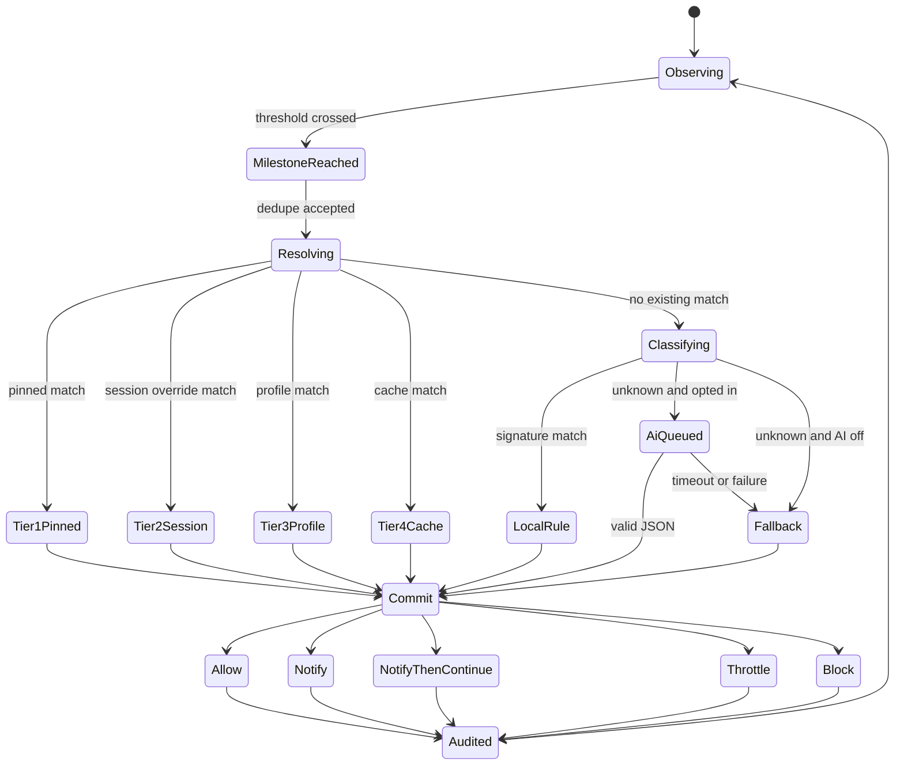

# Oasis: Data Saver Automation

**Document type:** Product Requirements Document
**Status:** Proposed
**Target platform:** Windows 10 and Windows 11
**Last updated:** 2026-11-23
**Implementation baseline:** Existing Oasis observation, identity, attribution, Activity events, policy store, enforcement coordinator, audit log, notification coordinator, and optional AI explanation layers

## 1. Purpose

Add a policy-driven Data Saver automation layer that separates observation, classification, policy resolution, enforcement, caching, and user notification.

The implementation must preserve Oasis's existing principles:

- Observation does not imply enforcement.
- Local rules and the policy engine work without AI.
- AI may classify unfamiliar activity, but it cannot directly apply a policy.
- Foreground traffic receives conservative handling.
- Background traffic may receive deterministic handling only after an Activity event qualifies.
- Every restriction is attributable, auditable, reversible, and user-visible.
- Raw packet payloads and local browsing history are never sent to AI or stored for this feature.

## 2. Existing System Integration

This feature uses existing Oasis components instead of introducing duplicate implementations:

| Concern | Existing integration |
| --- | --- |
| Process identity | `ApplicationIdentity`, publisher resolver, service resolver, process lineage, and process groups |
| Activity classification | `Activity::Detector`, `Activity::Event`, endpoint catalog, and activity classifier |
| Policy persistence | `NetworkPolicy` and `PolicyStore` |
| Policy activation | `PolicyScheduler` |
| Enforcement | `EnforcementCoordinator`, firewall, QoS, and WinDivert managers |
| Audit | `AuditEvent` and `AuditEventStore` |
| Notifications | `NotificationCoordinator` |
| AI settings/provider | `AiProviderSettings`, `AiProvider`, and `OpenAiCompatibleProvider` |
| Privacy | `AttributionPrivacySettings` and destination redaction helpers |

The new policy engine may reuse `NetworkPolicy.action`, but it must not assume `AI` or `automatic` policy origins have already been validated. The policy and audit schemas remain versioned.

## 3. Goals

- Distinguish foreground, foreground-idle, and background network behavior.
- Convert bandwidth observations into deterministic policy decisions.
- Apply a $50$ KiB/s download throttle to qualifying background events only when the active Data Saver profile permits it.
- Avoid blind foreground throttling.
- Use local signatures first and optional AI second.
- Cache repeat decisions only when the evidence fingerprint remains valid.
- Require a one-click or policy action for every throttled or blocked flow.
- Prevent stale decisions from overriding current user intent.
- Provide auditable reasons and reversible controls.

## 4. Non-goals

- Decrypting HTTPS, TLS, QUIC payloads, or ECH inner names.
- Inferring a process owner from a shared socket alone.
- Terminating processes.
- Changing VS Code, browser, package-manager, or operating-system settings automatically.
- Blocking package installs solely because they crossed a byte milestone.
- Sending raw packets, file payloads, complete process histories, or packet bodies to cloud AI.
- Using AI output to bypass policy validation or scope checks.

## 5. Modes

Data Saver has two modes for the first implementation:

| Mode | Behavior |
| --- | --- |
| Off | No Data Saver policy evaluation or automatic throttle |
| Monitor | Observe and classify; notify without restricting a foreground app; apply profile policy only where explicitly allowed |
| Enforce | Apply resolved allow, notify, throttle, or block decisions according to precedence |

A local profile may use Monitor or Enforce mode separately for background and foreground traffic. The global mode never overrides a user-pinned policy.

## 6. Canonical Flow Observation

Every packet milestone produces or updates a `FlowObservation`. It is not an enforcement request.

```json
{
  "observation_id": "obs_9f82a1",
  "timestamp": "2026-11-23T18:00:00Z",
  "process": {
    "pid": 14820,
    "parent_pid": 9104,
    "exe_name": "Code.exe",
    "exe_path": "C:\\Users\\...\\Code.exe",
    "exe_version": "1.95.2",
    "process_role": "main",
    "foreground_state": "foreground_active",
    "foreground_root_pid": 14820,
    "interaction_state": "unknown"
  },
  "flow": {
    "protocol": "TCP",
    "local_port": 54312,
    "remote_ip": "13.107.246.40",
    "remote_port": 443,
    "sni_hostname": "update.code.visualstudio.com",
    "sni_confidence": "dns_correlated",
    "dns_domain": "update.code.visualstudio.com",
    "cdn_multiplexed": false,
    "connection_id": "flow-stable-id"
  },
  "metrics": {
    "bytes_rx": 10485760,
    "bytes_tx": 18432,
    "duration_ms": 4200,
    "rate_rx_kbps": 19972,
    "milestone_mb": 10
  },
  "ux_signals": {
    "blocking_to_user": false,
    "latency_sensitive": false,
    "deferrable": true,
    "avoidable": false,
    "detector_tags": ["ide_core_update_signature"]
  }
}
```

### Required observation fields

- Stable observation ID and timestamp.
- PID, parent PID, executable name, canonical path, version, role, and foreground state.
- Protocol, local and remote endpoint, domain attribution fields, confidence, and multiplexed status.
- Cumulative bytes, duration, rate, and milestone bucket.
- UX signals and detector tags.

### Attribution rules

- The 5-tuple and process identity are the primary flow owner.
- DNS and SNI are enrichment, not proof of process behavior.
- DNS, TLS SNI, and QUIC remain metadata-only.
- ECH and QUIC may return an outer CDN name or no hostname.
- A CDN-multiplexed connection or weak SNI result prevents an automatic hard `block`.
- Shared connections require a process or dedicated executable to justify socket-level termination.

## 7. Volume Milestones

The established per-process detector remains at $10$ MiB, but Data Saver uses cumulative domain and process evidence rather than DNS volume.

Milestones:

- $10$ MB
- $25$ MB
- $50$ MB
- $100$ MB
- Each later doubling of the previous enforced or evaluated amount

The milestone gate is per `flow_id + process + domain + milestone bucket`. A milestone crossing must be deduplicated for at least one Data Saver evaluation window.

Milestones are evaluation triggers, not automatic enforcement triggers.

## 8. Policy Precedence

Policy resolution is deterministic and uses the first winning tier. Later tiers may supply defaults but cannot override a higher tier.

| Priority | Tier | Match | Default TTL | Override behavior |
| --- | --- | --- | --- | --- |
| 1 | User pinned rule | Executable + domain or wildcard | Persistent | Highest priority; records conflict when lower tiers disagree |
| 2 | User session override | Flow or executable + domain | Session end or app restart | Allows an alert action to unthrottle or unblock |
| 3 | Active profile rule | Profile + detector tags + foreground state | Profile lifetime | Handles deterministic background and known-domain behavior |
| 4 | Cached AI decision | Evidence fingerprint hash | 15 minutes to 7 days | Evicted on version, volume-bucket, duration-bucket, or source changes |
| 5 | Safe fallback | Foreground state and context | Immediate, never cached | Foreground: allow or notify; background: notify or $50$ KiB/s gentle throttle |

The first hard `block` requires a user-pinned rule or a high-confidence profile rule. Cached AI decisions may only throttle or block when their classification, scope, and evidence pass validation.

## 9. Evidence Cache Key

The cache key is a hash of:

- Normalized executable name.
- Executable version.
- Normalized SNI, DNS domain, or ASN fallback.
- Process role.
- Foreground state.
- Receive-byte bucket: `10_25MB`, `25_50MB`, `50_100MB`, or `100MB_plus`.
- Duration bucket: `burst_<10s`, `sustained_10_60s`, or `long_>60s`.
- Data Saver source: metered hotspot, manual toggle, or battery saver.

Cache entries must also contain the original observation ID, schema version, fingerprint, result, timestamp, expiration, and audit information.

## 10. Cache TTL

| Decision source | TTL |
| --- | --- |
| High-confidence AI app/update classification, confidence $>= 0.85$ | 7 days |
| Domain-only heuristic with no process/SNI corroboration | 24 hours |
| Low-confidence or ambiguous classification, confidence $< 0.70$ | 15 to 60 minutes |
| Local signature match | 30 days or catalog version lifetime |
| User session override | Session end or app restart |
| User pinned rule | Persistent |

Every cache entry is invalidated when executable version changes or the evidence changes enough to enter another byte/duration/source bucket. Local catalog updates invalidate stale local signature matches.

## 11. Policy Decision Contract

AI, local rules, profile rules, and fallback all produce the same `PolicyDecision`.

```json
{
  "classification": "app_update",
  "confidence": 0.92,
  "action": "throttle",
  "scope": "domain",
  "throttle": {
    "rx_kbps": 64,
    "tx_kbps": 0,
    "until": "foreground_change"
  },
  "cache_ttl_seconds": 604800,
  "expires_at": "2026-11-30T18:00:00Z",
  "session_override_allowed": true,
  "rule_conflict": {
    "has_conflict": false,
    "conflicting_tier": null,
    "resolution": "applied"
  },
  "evidence_summary": {
    "exe": "Code.exe",
    "sni": "update.code.visualstudio.com",
    "milestone_mb": 10,
    "foreground_state": "foreground_active",
    "ux_profile": "deferrable_non_blocking"
  },
  "reason_short": "VS Code core update download detected.",
  "next_steps": [
    "Set Update: Mode to manual or none in VS Code settings",
    "Run the update while connected to an unmetered network"
  ]
}
```

Allowed enums:

- Classification: `app_update`, `extension_update`, `package_install`, `ai_inference`, `media_stream`, `telemetry`, `policy_action`, `unknown`.
- Action: `allow`, `notify`, `notify_then_continue`, `throttle`, `block`.
- Scope: `flow`, `domain`, `executable`, `group`.
- Throttle `until`: `foreground_change`, `milestone_next`, `session_end`, `manual_override`.

Unknown AI values reject the decision. Missing required fields reject it. A low-confidence decision is capped at `notify` or `notify_then_continue`.

## 12. Async Evaluation Pipeline

1. Packet/flow hooks update counters and perform precedence lookup from memory.
2. A milestone crossing is deduplicated by `flow_id + milestone + byte bucket`.
3. Tier 5 fallback is applied or shown immediately.
4. A `ClassifyFlowJob` is queued for local signatures and optional AI.
5. Local rules run synchronously without network access.
6. Cloud AI runs only if local rules return unknown and cloud AI is opted in.
7. The validated policy decision is committed to cache and audit.
8. A throttled or blocked result triggers a deduplicated notification.

No job may stall packet capture or GUI responsiveness. Packet hooks must never wait for SQLite, disk, HTTP, or policy UI operations.

## 13. Foreground and Background Behavior

### Background process

A qualifying existing Activity event or detector tag is converted to a profile candidate. The default deterministic background fallback is a download throttle of $50$ KiB/s, subject to the active profile and user precedence.

Before throttle, the engine checks:

- Whether the executable is protected.
- Whether a process is foreground or foreground-idle.
- Whether an explicit allow/session override exists.
- Whether the 5-tuple is shared or multiplexed.
- Whether enforcement channel ownership is available.

### Foreground active app

Do not throttle on first contact. Evaluation starts at $10$ MB or a later configured milestone.

Initial safe defaults:

- `package_install`, `ai_inference`, `media_stream`, or interactive activity: `allow` or `notify_then_continue`.
- `app_update`, `extension_update`, or `deferrable`: `notify` then optional throttle.
- `unknown`: `notify` or continued allow.
- High-confidence dedicated updater: throttle or block only if the profile permits it.

`blocking_to_user` and `latency_sensitive` must downgrade automatic block to notify or an optional delayed throttle.

### Foreground idle

An app with the foreground window but no current interaction may use background-like handling. The transition to idle must be measured by foreground association freshness and process state, not window-title guessing.

## 14. UX Requirements

Any transition to throttle or block creates one deduplicated notification containing:

- What changed.
- Executable, domain, milestone, and reason.
- Whether download, upload, or both are affected.
- Allow Once.
- Always Allow.
- Inspect Application or Activity details.
- For known app updates, the app-specific next step supplied by local rules or AI suggestions.

Allow Once creates a Tier 2 session override for the flow or executable/domain pair.

Always Allow creates a Tier 1 persistent pinned allow rule. It requires explicit user confirmation because it overrides lower-tier AI decisions.

The notification must use existing `NotificationCoordinator` dedupe and priority behavior. Critical enforcement failures bypass cooldown limits.

## 15. Notification Dedupe and Audit

Every policy commit writes an immutable audit record containing:

- Timestamp.
- Observation and flow IDs.
- Trigger milestone.
- Applied action and scope.
- Precedence tier and matched rule/cache key.
- Evidence summary.
- Policy ID.
- Enforcement channel result.

The audit stores metadata only. It must not contain packet payloads or API credentials.

## 16. Groq Cloud AI Integration

Groq is one optional OpenAI-compatible provider, not a policy engine.

Initial configuration:

- Environment variable for the key: `GROQ_API_KEY`.
- Full HTTPS chat-completions endpoint supplied by the user or a signed default configuration.
- A user-selected model.
- Timeout $5$-$60$ seconds.
- Response size cap.
- AI opt-in remains disabled by default.

The provider receives no executable path or local IP. The payload contains only a redacted bounded evidence summary, executable base name, domain or redacted domain token, foreground state, process role, volume bucket, duration bucket, and UX profile.

The model must return one JSON object matching `PolicyDecision`. Text-only and policy-shaped malformed answers are rejected. The application validates and normalizes every field locally.

Cloud calls execute through a worker thread or Qt concurrent job and never block the network capture or GUI.

## 17. Privacy and Security

- Cloud AI requires explicit opt-in.
- API key is read only from environment variable and never stored in policy, cache, or logs.
- HTTPS required unless loopback is used for a local provider.
- Executable paths, local IP addresses, raw domains with user-specific subdomains, and policy IDs are excluded or hashed where appropriate.
- Users can review the exact bounded payload before sending.
- Provider responses are sanitized and capped.
- Provider failures fall back to local policy evaluation.
- Cache entries never store payload bytes or API responses containing free-form remote text unless it is bounded and privacy-reviewed.

## 18. State Machine



## 19. Failure and Rollback Requirements

- AI unavailable: use local rule or safe fallback.
- Policy cache unavailable: resolve locally and do not block.
- Policy store unavailable: never apply an uncatalogued automatic block.
- Enforcement channel unavailable: notify a failed attempt and record `NotApplied` or `Failed`.
- Shared socket: prefer throttle over block.
- Stale cache: evict and reclassify.
- App version changes: invalidate executable-level AI cache entries.
- Session override expires: withdraw only that override, preserve pinned and profile state.
- Data Saver disabled or leaves Enforce: withdraw only automatic policy ownership; preserve user-pinned rules.
- Emergency restore: remove only automatic/AI policies; preserve user rules.

## 20. Functional Acceptance Criteria

- A qualifying background event produces a $50$ KiB/s enforcement request and one notification.
- A foreground app crossing $10$ MB never waits for AI to continue traffic.
- Known package installs remain allowed or notified instead of blocked merely for large volume.
- Known app/extension updates can be locally classified without cloud AI.
- Cloud AI cannot apply a policy directly.
- Malformed, oversized, or unknown JSON decisions are rejected.
- A shared CDN or ECH-outer-only result cannot produce an automatic hard block.
- Pinned rules win over every lower tier.
- Session overrides expire correctly.
- Cache entries expire and invalidate on app version or bucket changes.
- Every policy transition creates an audit record.
- Throttle/block notifications support Allow Once and Always Allow.
- AI failure or timeout degrades to a local or safe fallback.
- Data Saver disable and emergency restore do not remove user-pinned rules.

## 21. Test Requirements

Tests must cover:

- Contract parsing and schema rejection.
- Policy precedence and conflict resolution.
- Foreground/background classification transitions.
- Cache key bucket boundaries and invalidation.
- Flow, executable, domain, and group scope matching.
- Multiplexed CDN and ECH fallback behavior.
- Milestone dedupe and re-evaluation.
- Local signature matches and unknown signatures.
- Groq adapter success, timeout, malformed JSON, HTTP failure, and missing key.
- Policy engine isolation from provider output.
- Audit immutability and payload-free exports.
- Notification dedupe and Allow Once/Always Allow behavior.
- Automatic policy withdrawal on disable and restore.
- Live WinDivert/firewall behavior where elevated Windows testing is available.

## 22. Rollout

### Phase 1: Observation and policy engine

Deterministic rules, safe fallback, audit, cache, and policy resolution without AI enforcement.

### Phase 2: Foreground milestones and notifications

Flow volume tracking, app/domain attribution, notification actions, and session overrides.

### Phase 3: Groq AI opt-in

Structured classifier adapter, exact payload preview, local validation, and cache commit.

### Phase 4: Live validation

Elevated Windows testing, real updater fixtures, package-manager flows, IDE updates, CDN multiplexing, and rollback.
